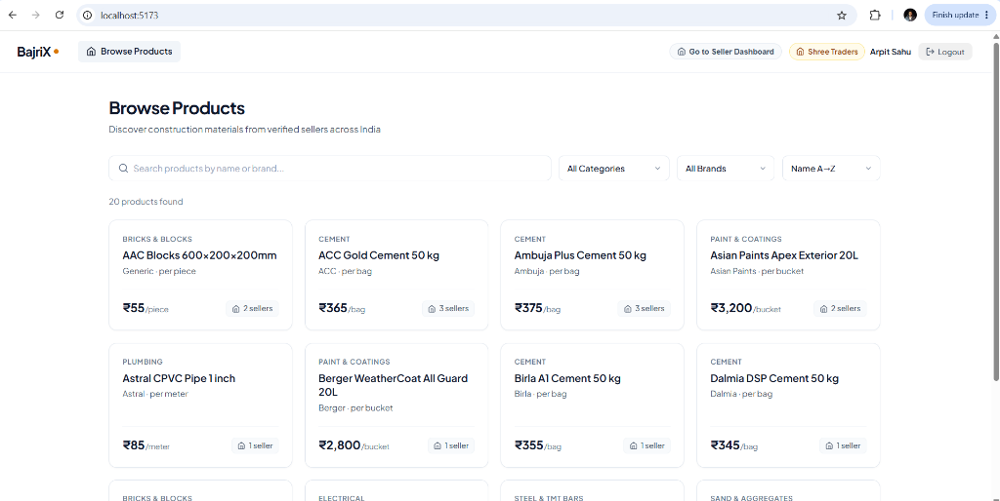
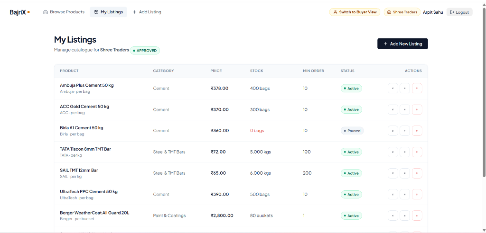
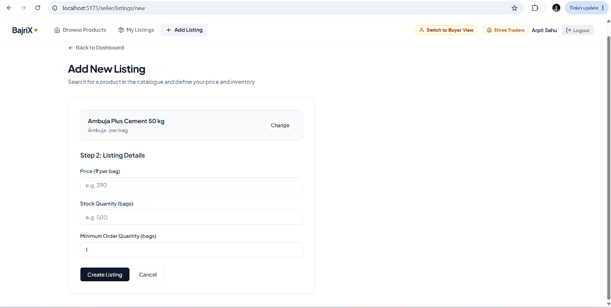

# BajriX — Construction Materials Marketplace

A marketplace platform connecting construction material buyers with local sellers. Buyers can browse products, compare prices across sellers, and see stock availability. Sellers can manage their product catalogue with pricing, stock, and availability controls.

---

## Application Screenshots

### 🛒 Buyer Experience — Product Search & Multi-Seller Catalog
*Buyers can search construction products, filter by category or brand, and see the lowest price available across local sellers.*



### 📦 Seller Dashboard — Inventory Management
*Sellers (e.g., Shree Traders) can manage listings, monitor stock levels, adjust prices, and toggle listing availability.*



### ➕ Add Listing — Catalog Expansion
*Sellers can find canonical catalog products and define their pricing, available stock, and minimum order quantity (MOQ).*



---

## Quick Start

### Prerequisites
- Java 17+
- Node.js 18+
- PostgreSQL 14+ (or use the pre-configured Supabase instance)

### 1. Start the Backend

```bash
# From the project root
./mvnw spring-boot:run
```

The backend starts on `http://localhost:8080`.

> **Database Setup Options:**
> - **Option A (Zero Setup — Default):** By default, the application connects to the pre-configured, hosted Supabase PostgreSQL instance. You don't need to install or configure any database locally — just run `./mvnw spring-boot:run`!
> - **Option B (Local PostgreSQL):** To use your own local PostgreSQL database, create a database named `bajrix` and pass your credentials via environment variables:
>   ```bash
>   export SPRING_DATASOURCE_URL=jdbc:postgresql://localhost:5432/bajrix
>   export SPRING_DATASOURCE_USERNAME=postgres
>   export SPRING_DATASOURCE_PASSWORD=your_password
>   ./mvnw spring-boot:run
>   ```
>   Flyway will automatically execute migrations `V1` through `V8`, creating all tables, indexes, and seed data.

### 2. Start the Frontend

```bash
cd frontend
npm install
npm run dev
```

The frontend starts on `http://localhost:5173`.

### 3. Try It Out

1. **Browse as Guest Buyer** — The app loads in buyer mode by default. Anyone can search for "cement", filter by category or brand, and click any product to compare seller prices and MOQs.
2. **Sign In** — Click the "Sign In" button in the navbar or go to `http://localhost:5173/login`. You can click any **1-Click Demo Login card** or enter credentials manually.
3. **Manage Inventory as Seller** — Once logged in as a seller, manage your listings in the Seller Dashboard, update prices/stocks/MOQs, pause listings, or click "Add New Listing" to add products.
4. **Switch Between Buyer & Seller Views** — Use the "Switch to Buyer View" / "Go to Seller Dashboard" pill in the navbar to seamlessly toggle modes.

---

### 🔑 Demo Accounts & Credentials

All test accounts are pre-seeded via Flyway migration `V8`.
- **Default password for all demo accounts:** `BajriX@123`
- *(Tip: You can also click any demo account card on the `/login` page for instant 1-click sign-in).*

| Role | User Name | Linked Business / Profile | City | Status | Email | Password |
|:---|:---|:---|:---|:---:|:---|:---|
| **Seller** | Arpit Sahu | Shree Traders | Pune | `APPROVED` | `sahuarpit33@gmail.com` | `BajriX@123` |
| **Seller** | BuildMart India Rep | BuildMart India | Mumbai | `APPROVED` | `buildmart.seller@gmail.com` | `BajriX@123` |
| **Seller** | Rajesh Kumar | Raj Enterprises | Delhi | `APPROVED` | `raj.seller@gmail.com` | `BajriX@123` |
| **Seller** | Kirit Mehta | Mehta Building Materials | Ahmedabad | `APPROVED` | `mehta.seller@gmail.com` | `BajriX@123` |
| **Buyer** | Priya Sharma | Commercial Contractor Profile | Bangalore | `ACTIVE` | `priya.buyer@gmail.com` | `BajriX@123` |
| **Buyer** | Arpit Sahu (Buyer) | Individual Homebuilder Profile | Pune | `ACTIVE` | `arpitsahu8279@gmail.com` | `BajriX@123` |

---

## Architecture

### Tech Stack

| Layer | Technology |
|-------|-----------|
| Backend | Spring Boot 4.1, Java 17, Spring Data JPA |
| Database | PostgreSQL with Flyway migrations |
| Frontend | React 18, Vite, React Router, Axios |
| Testing | JUnit 5, Mockito, MockMvc |

### Project Structure

```
bajriX/
├── src/main/java/com/bajriX/bajriX/
│   ├── config/          # CORS configuration
│   ├── controller/      # REST controllers (buyer + seller)
│   ├── dto/             # Request/response DTOs (Java records)
│   ├── entity/          # JPA entities
│   ├── enums/           # SellerStatus
│   ├── exception/       # Custom exceptions + GlobalExceptionHandler
│   ├── repository/      # Spring Data repositories + Specifications
│   └── service/         # Business logic
├── src/main/resources/
│   └── db/migration/    # Flyway SQL migrations (V1–V6)
├── src/test/java/       # Unit + controller tests
└── frontend/            # React application
    └── src/
        ├── api/         # Axios client + API functions
        ├── components/  # Layout, reusable components
        ├── context/     # Auth context (role switching)
        ├── hooks/       # useDebounce
        └── pages/       # Buyer + Seller pages
```

### Database Schema

```
categories ──< products ──< seller_listings >── sellers
```

- **Product** = canonical catalog item (e.g., "UltraTech PPC Cement 50 kg")
- **Seller Listing** = a seller's offer for a product (price, stock, MOQ, availability)
- **Unique constraint** on `(seller_id, product_id)` prevents duplicate listings

---

## Key Architectural Decisions

### 1. Product ≠ Listing Separation
Products are platform-level catalog items; listings are seller-specific offers. This avoids data duplication (product name/description stored once, not per seller) and allows platform-level control (delisting a product) independent of seller decisions.

### 2. Authorization by Query Scoping
Every seller operation uses `findByIdAndSellerId()` — the seller ID comes from the `X-Seller-Id` request header and is always part of the query predicate. There is no code path where a seller can access another seller's data, even accidentally.

### 3. Optimistic Locking for Concurrency
`seller_listings` has a `version` column managed by JPA's `@Version`. If two concurrent updates collide, the second gets a `409 Conflict` with a user-friendly message. This is preferable to pessimistic locking because write conflicts on the same listing are rare, and pessimistic locks would introduce contention.

### 4. Three-Layer Validation
- **Layer 1:** Jakarta Bean Validation on DTOs (`@NotNull`, `@Positive`, `@Min`)
- **Layer 2:** Business rules in service layer (MOQ ≤ stock, no duplicates)
- **Layer 3:** Database constraints (`CHECK`, `UNIQUE`, `FOREIGN KEY`)

### 5. Specification Pattern for Search
Dynamic search filters are composed using Spring Data's `Specification` interface. Each filter (search query, category, brand) is a standalone predicate combined with `.and()`. This is type-safe and extensible without modifying repository methods.

### 6. JWT Authentication with Role & Tenancy Boundaries
Authentication is implemented via a JWT token issued upon login (`/api/auth/login`) with BCrypt-hashed passwords. The token payload encodes the user's role (`BUYER` or `SELLER`) and associated `sellerId`. The backend `SellerAuthInterceptor` verifies the JWT signature and role on protected seller routes (`/api/seller/**`), and ensures requests cannot manipulate another seller's inventory. The frontend provides a dedicated `/login` page with 1-click demo accounts for frictionless evaluation.

---

## Assumptions

1. **Buyers are anonymous by default** — no account required for browsing and comparing offerings.
2. **Only APPROVED sellers' listings are visible** to buyers in all queries.
3. **Setting stock to 0 automatically marks listing as unavailable** (a seller shouldn't be selling what they don't have).
4. **Cannot re-enable a listing with zero stock** — must add stock first.
5. **Products are managed by the platform**, not by sellers. Sellers can only create listings for existing products.
6. **A seller can list a product only once** — enforced at both application and database level.
7. **Seller status is managed externally** (admin/approval process not built).
8. **Hard delete for listings** — sellers can fully remove a listing, not just disable it.

---

## What I Did NOT Implement

- **Payment/checkout** — out of scope per requirements
- **Self-service seller registration & KYC** — sellers and users are pre-seeded
- **Admin panel** — no seller approval workflow UI
- **Image upload** — products use `image_url` field but no direct upload mechanism
- **Notifications** — no email/SMS
- **Full-text search** — using ILIKE with trigram index (sufficient for MVP)
- **Caching** — no Redis layer
- **API versioning** — not needed for MVP

---

## What I Would Improve With More Time

1. **Elasticsearch** — Replace ILIKE search with full-text search supporting typo tolerance, synonyms, and faceted results.
2. **Redis caching** — Cache product detail pages and category lists with event-driven invalidation.
3. **Cursor-based pagination** — Replace OFFSET pagination with keyset pagination for consistent performance at scale.
4. **API rate limiting** — Prevent search endpoint abuse.
5. **Event-driven architecture** — Listing changes publish events that update search indexes, caches, and analytics.
6. **JWT authentication** — Replace `X-Seller-Id` header with proper token-based auth.
7. **Comprehensive integration tests** — Using Testcontainers with a real PostgreSQL instance.
8. **OpenAPI documentation** — Auto-generated API docs with Springdoc.
9. **Audit logging** — Track who changed what and when for seller listings.

---

## Scale Considerations (1M products, 10M listings)

| Current Approach | At Scale | What Changes |
|:---|:---|:---|
| ILIKE with GIN trigram index | Elasticsearch cluster | Async indexing pipeline |
| OFFSET pagination | Keyset/cursor pagination | `WHERE id > :lastId LIMIT :size` |
| Single PostgreSQL | Read replicas + connection pooling (PgBouncer) | Route buyer reads to replicas |
| JPA Specifications | Elasticsearch Query DSL | Richer faceted search |
| Synchronous writes | Event-driven (Kafka/RabbitMQ) | Decouple write from index updates |
| No caching | Redis with TTL + invalidation | Cache hot product pages |
| COUNT(*) for total | Approximate counts or remove total | Avoid expensive full-table scans |

---

## Running Tests

```bash
./mvnw test
```

Tests cover:
- **SellerListingService** (unit) — all business rules, authorization, edge cases (15 tests)
- **SellerListingController** (web layer) — HTTP contract, validation, error responses (6 tests)
